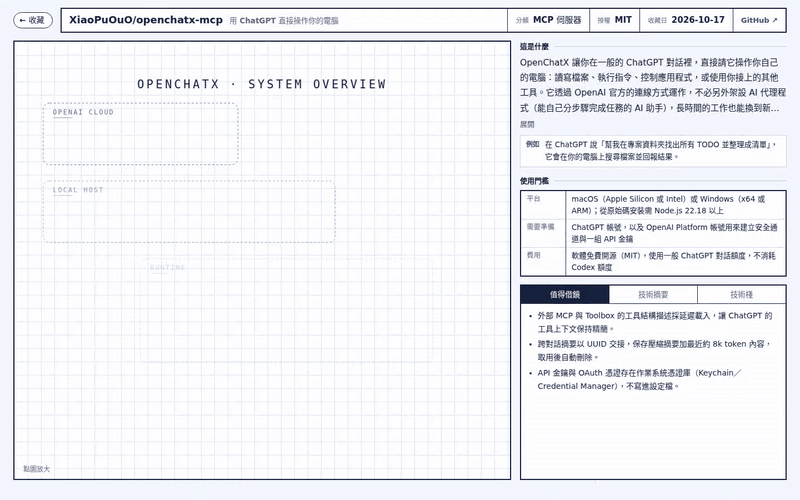

# RepoBox

滑 Threads、X 看到不錯的 GitHub 專案，按一下分享就收進你自己的私人 repo。幾分鐘後，你自己的 Claude 訂閱會讀完那個專案，寫好白話介紹、使用門檻、技術摘要和一張架構圖。



- **收得快**：手機分享選單或電腦書籤列，一下就收進來，不用開別的 App。
- **看得懂**：「這是什麼」用白話寫，附一個實際例子；「使用門檻」列出平台、要準備什麼、要不要錢。
- **看得到架構**：每個專案都有一張架構圖，點節點就看它連到哪些元件。
- **資料是你的**：結果是 Markdown 加 SVG，存在你自己的私人 repo，GitHub、Obsidian、VS Code 都能直接讀。

<p>
  
  
</p>

分析結果是繁體中文。

## 它怎麼運作

```
手機分享 / 書籤 ──► 你的收藏網頁 ──► 私人 repo 的 inbox/
                                         │
                       GitHub Actions + 你的 Claude 訂閱
                                         │
                     library/ 寫進介紹、使用門檻、架構圖 ──► 收藏網頁的書庫
```

沒有伺服器、沒有資料庫，也沒有共用網站。網頁是你 fork 出來的 GitHub Pages，分析跑在你自己的 GitHub Actions。

## 安裝

需要：GitHub 帳號、Claude Pro 或 Max 訂閱，以及裝好 Claude Code 的電腦（產生 token 用）。全程在 GitHub 網頁上點，只有第 2 步要在終端機打一行指令。

### 1. 架收藏網頁

1. Fork 本 repo，到 fork 的 **Actions** 分頁按啟用。
2. **Settings → Pages → Source** 選 **GitHub Actions**，再到 **Actions → pages → Run workflow** 跑一次。

網頁會在 `https://<帳號>.github.io/repobox/`。

### 2. 建收藏 repo

1. 新建一個**私人** repo，名稱填 `repobox-library`，勾 **Add a README file**。
2. 在裡面 **Add file → Create new file**，檔名填 `.github/workflows/repobox.yml`，貼上下面內容。`<帳號>` 換成你的帳號；`<SHA>` 到你 fork 的 **Commits** 頁，按最上面那筆的 **Copy full SHA** 貼上。

   ```yaml
   name: repobox
   on:
     push: { branches: [main], paths: ['inbox/*.json'] }
     workflow_dispatch:
       inputs:
         url: { description: 'GitHub repo URL to (re)analyze; empty = process inbox', required: false, default: '' }
   concurrency: { group: repobox, cancel-in-progress: false }
   permissions: { contents: write }
   jobs:
     repobox:
       uses: <帳號>/repobox/.github/workflows/analyze.yml@<SHA>
       with: { url: '${{ inputs.url }}' }
       secrets: { CLAUDE_CODE_OAUTH_TOKEN: '${{ secrets.CLAUDE_CODE_OAUTH_TOKEN }}' }
   ```

3. 在裝了 [Claude Code](https://claude.com/claude-code) 的終端機執行 `claude setup-token`，登入後會印出一串 token。到收藏 repo 的 **Settings → Secrets and variables → Actions → New repository secret**，名稱填 `CLAUDE_CODE_OAUTH_TOKEN`，貼上 token。

### 3. 每台裝置連一次

1. GitHub **Settings → Developer settings → Fine-grained tokens** 建一把 token：只選 `repobox-library`，權限只開 **Contents: Read and write**。
2. 打開收藏網頁的設定，填上 `<帳號>/repobox-library` 和這把 token。
3. Android 把網頁加到主畫面，分享選單就有 RepoBox；電腦把網頁上的書籤按鈕拖到書籤列。

## 授權

[MIT](LICENSE)。架構圖由 [arch-blueprint](https://github.com/cholateio/arch-blueprint) 繪製。
