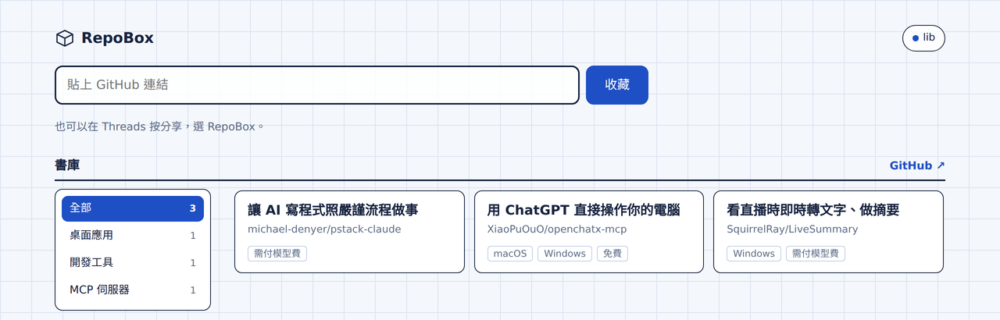
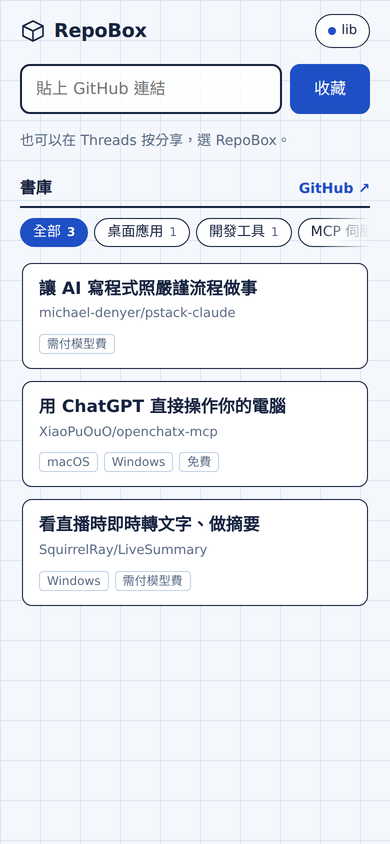
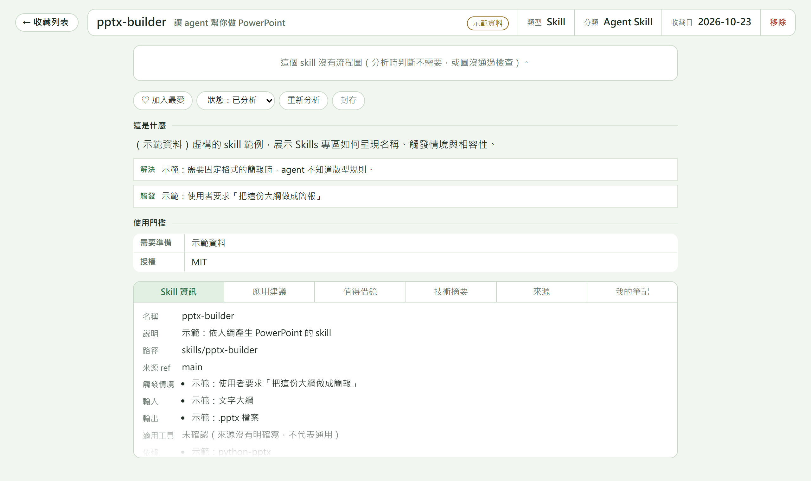

# GitHub Collective Hub

**繁體中文** | [English](README.en.md)

把靈感，收進未來。

在 Threads、朋友訊息或語音裡看到不錯的 GitHub 專案或 AI Skill，貼上連結、分享文字或逐字稿，就收進你自己的**私人** GitHub repo。幾分鐘後，GitHub Actions 用你自己的 Claude 訂閱寫好繁體中文介紹、使用門檻、應用建議，以及架構圖或流程圖。

本專案改編自 [cholateio/repobox](https://github.com/cholateio/repobox)（基底 commit `8132ed5bcd430f9f92634396a6a67c99a89a3fb6`），保留它的架構：收藏網頁 → 私人收藏庫 `inbox/` → GitHub Actions → Claude 分析 → 驗證後的 `library/` → 收藏網頁。

<p>
  
  
</p>

## 能做什麼

- **兩種收藏**：GitHub 專案（`owner/repo`），以及 Skill（`owner/repo` 裡的某個 `SKILL.md`；同一個 repo 的多個 skill 可以分別收藏）。
- **多種入口**：貼 GitHub 網址；貼 Threads 分享內文（一次擷取多個網址，先列候選再確認）；貼逐字稿或用麥克風口述；Android 分享選單；電腦書籤。
- **用途標籤**：簡報類、程式類、語音類、AI 工具、設計資源、教育應用，可多選、可自訂；AI 建議標籤與你的手動標籤分開，按一下才採用。
- **整理**：所有收藏、靈感收件匣、我的最愛、Skills 專區、封存；搜尋、多標籤篩選、卡片／列表、最近收藏／最近分析排序。
- **你的筆記不會被覆寫**：筆記、手動標籤、最愛、狀態存在收藏庫的 `user.json`，分析流程只讀不寫。
- **可恢復的錯誤**：token 失效、權限不足、API 限流、分析失敗、圖沒通過安全檢查，都有清楚的狀態與重試入口。



## 它怎麼運作

```
貼上網址／分享文字／語音 ──► 收藏網頁 ──► 私人收藏庫 inbox/<id>.json
                                              │ push
                              GitHub Actions：plan → analyze（Claude，無 shell）→ publish（重新驗證）
                                              │
                    library/*.md|json|svg、index.json ──► 收藏網頁（用你的 token 讀取）
```

沒有資料庫。網頁可以放在 GitHub Pages（每台裝置貼一次 token），也可以部署到 Railway（用 GitHub 登入，token 只在伺服器）；分析都跑在你自己的 Actions。

## 安裝

完整步驟（Windows 本機預覽、測試、GitHub Pages、私人收藏庫、Secrets 清單）見 **[docs/setup.md](docs/setup.md)**。摘要：

1. 本機預覽：`node scripts/preview.mjs`，打開 <http://127.0.0.1:8080/>，按「以示範資料瀏覽」或連結本機模擬收藏庫。
2. 把這個 repo 推到你自己的 GitHub，開啟 Pages。
3. 用 `library-template/` 建一個**私人**收藏庫，把 caller workflow 的 `uses:` 釘到你 repo 的 40 字元 commit SHA。
4. 收藏庫 Actions secret：`CLAUDE_CODE_OAUTH_TOKEN`（`claude setup-token` 產生）。
5. 每台裝置在網頁設定貼一次 fine-grained token（只限收藏庫，Contents: Read and write）。

**想用 GitHub 登入、不在裝置上貼 token**：部署到 Railway，見 **[docs/railway.md](docs/railway.md)**。同一個服務提供網頁、GitHub OAuth 登入（只確認身分、只允許指定的 GitHub user ID）與收藏 API；收藏庫 token 只放在伺服器的環境變數。

## 隱私與安全

- **網頁公開、收藏私人**：免費方案的 GitHub Pages 是公開網站，但裡面只有程式碼與虛構示範資料；你的收藏只透過你瀏覽器裡的 token 從私人收藏庫讀取。
- GitHub token 只存在你的瀏覽器、只送到 `api.github.com`，不進網址、紀錄或 git；分享文字裡如果夾帶 token 會被遮蔽。網頁不載入任何第三方程式碼。
- Claude 讀的是陌生人的程式碼與 skill，當成不可信資料：沒有 shell、不連網、只能寫一個暫存資料夾；skill 裡的指令絕不遵循、不執行、不安裝。產出由另一個不跑 Claude 的 job 重新驗證才寫入。
- 架構圖與流程圖在寫入前、顯示前各過一次 SVG 白名單；沒通過就不顯示。
- 語音輸入使用瀏覽器的辨識服務（Chrome／Edge 會送到廠商伺服器）；不想送出就貼逐字稿。錄音檔上傳轉錄是第二階段，尚未提供（[docs/asr-adapter.md](docs/asr-adapter.md)）。

## 文件

- [docs/collective-plan.md](docs/collective-plan.md)：架構盤點、資料格式、相容性與遷移
- [docs/setup.md](docs/setup.md)：安裝、部署、Secrets
- [docs/railway.md](docs/railway.md)：Railway 部署與 GitHub 登入
- [docs/specs/repobox.md](docs/specs/repobox.md)：上游 RepoBox 規格（安全設計的原始決策）

## 授權

[MIT](LICENSE)。上游 RepoBox © cholateio；架構圖由 [arch-blueprint](https://github.com/cholateio/arch-blueprint) 繪製。
